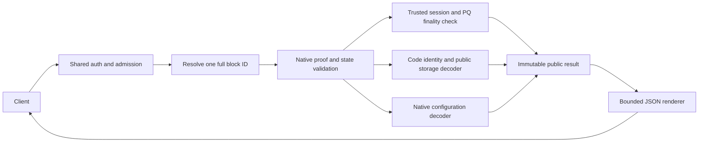

# Post-quantum explorer RPC detailed design

**Revision:** 2, corrected after design audit; proposed for external design review.
**Implementation status:** native R1–R4 implementation added; see the
[implementation and validation index](explorer-pq-rpc-implementation.md).
The requirements below preserve the reviewed design; acceptance is recorded separately.
**Source baseline:** `d41eae93dbbcb2af730b4ff5015458794ef04cb1`.

This document specifies the implementation of R1–R4 in
[the parity contract](explorer-pq-rpc-contract.md). Normative words MUST, MUST NOT
and SHOULD describe proposed requirements, not shipped behavior. The attached
[JSON Schema](explorer-pq-rpc-v1.schema.json) defines new request/result fragments.
Legacy result fields remain governed by their existing contracts. Revision 2 refines
this unshipped v1 contract; it does not change the wire `schema_version`. See the
[audit and validation receipt](explorer-pq-rpc-audit.md) for the reviewed findings,
reproducible checks and remaining implementation gates.

## 1. Decisions and compatibility

| Decision | Rationale |
| --- | --- |
| Extend existing methods; add only the missing `/getProofQuery` REST route | Avoid a parallel explorer API and unrestricted native-query proxy |
| R1 serves PQ carriers by default | The current PQ response is an error, so no successful classical result shape is replaced |
| R2 requires `include_pq: true`; R4 requires `include_decoded: true` | Existing account classification and missing-config behavior remain stable for old clients |
| `block_id` pins the complete observation; `seqno` remains accepted | A height alone cannot distinguish forks |
| Verify PQ finality through existing native proof/signature code | JSON rendering must not implement a second cryptographic verifier |
| Exact code identity precedes public-state decoding | Storage shape and wallet labels do not establish authority |
| Typed config absence is explicit only in the opt-in view | A missing optional parameter must not look like a timeout or malformed policy |

All four interfaces are read-only. They do not select or enable consensus suites,
construct signing requests, broadcast messages, mutate accounts, or access signer
files. Indexed histories and off-chain labels remain in the query service.

## 2. Shared wire contract



R3 uses the shared admission path and allowlisted native query forwarding; its raw
reply does not enter the verified-result path shown above until a consumer verifies it.

### 2.1 Transport and envelopes

Support both `POST /jsonRPC` with `{jsonrpc:"2.0",id,method,params}` and named
REST POST routes with the params object as body. Authentication, CORS, request
limits and source-IP attribution use the existing dispatch path.

Answers use the server-wide JSON-RPC 2.0 shape documented in `doc/openapi.yaml`.
Success, HTTP 200:

```json
{"jsonrpc":"2.0","id":7,"result":{}}
```

Error, also HTTP 200, on `/jsonRPC` and on the REST routes alike (REST answers
carry id null):

```json
{
  "jsonrpc":"2.0","id":7,
  "error":{
    "code":-32009,
    "message":"BLOCK_ID_MISMATCH",
    "data":{"schema_version":1,"reason":"BLOCK_ID_MISMATCH","retryable":false}
  }
}
```

`error.data` (`ErrorInfo` in the schema) carries the stable reason; it never
contains raw liteserver exceptions or echoed BOCs. For these views the message is
the reason string. There is no `ok` member and no top-level `code`. Only refusals
made before any method runs (authentication 401, ingress budget 429, unknown GET
path 404, HTTP method 405, content type 415) use another HTTP status, with the
same error body.

### 2.2 Primitive types

| Type | Encoding and bounds |
| --- | --- |
| `Bits256` | Standard padded RFC 4648 base64 of exactly 32 bytes; no hex/base64url ambiguity in new fields |
| `Bytes` | Standard padded base64; decoded length checked before allocation |
| `U64` | Canonical decimal string, `0` or nonzero digit followed by digits; range 0…18446744073709551615 |
| `U32`, `U16`, `U8` | JSON integer with the corresponding unsigned range; booleans and fractions are rejected |
| `I32` | JSON integer in signed 32-bit range |
| Unix time | `U32`, seconds since epoch |
| Raw address | Canonical `workchain:64-lowercase-hex-digits`; no local path or key alias |
| Shard | Signed 64-bit decimal string using the existing block-ID convention |

`BlockId` contains exactly `workchain`, `shard`, `seqno`, `root_hash`, `file_hash`
plus the existing optional `@type`. `seqno` is limited to 0…2147483647 because
existing lookup parameters use signed 32-bit values. Native unsigned TL metadata
such as `cc_seqno`, `validator_set_hash` and `slot` is exposed as `U32`, preserving
its bit pattern rather than emitting negative numbers.

### 2.3 Block selection

New views accept optional `block_id` and existing `seqno`:

1. Validate the complete selector before any upstream request. A `block_id` must
   be a masterchain ID: workchain -1 and shard `-9223372036854775808`.
2. If both selectors are present, their seqnos MUST agree.
3. Resolve that height, then compare **all five identity fields** with `block_id`.
   A mismatch answers `BLOCK_ID_MISMATCH` (-32009); never silently retry against
   another fork/head.
4. If neither is supplied, resolve latest once and use that immutable ID for the
   entire request. Return it so the client can pin subsequent calls.
5. Every account/config/proof subquery uses that same ID. Hash mismatches in an
   upstream reply are invalid evidence, not an absent object.

R1 requires either `seqno` or `block_id`, and requires seqno >= 1. Genesis returns
a typed unsigned-block error; it is not a zero-signature certificate. R2/R4 may
select genesis only if the native account/config proof path supports it; otherwise
return `BLOCK_UNAVAILABLE`, never reinterpret zero as latest in the new view.

### 2.4 Error reasons

Every reason travels in `error.data` of an HTTP 200 answer.

| Reason | JSON-RPC code | Retryable | Meaning |
| --- | --- | --- | --- |
| `INVALID_ARGUMENT` | -32602 | false | Type, selector, encoding or request bound invalid |
| `UNSIGNED_BLOCK` | -32602 | false | Genesis requested through R1 |
| `BLOCK_ID_MISMATCH` | -32009 | false | Caller-supplied complete ID disagrees with resolved identity |
| `BLOCK_UNAVAILABLE` | -32004 | false | Historical data unavailable on this node (its state was garbage-collected); use an archival node |
| `CONFIG_PARAM_ABSENT` | -32004 | false | R4 `include_decoded` view of an absent parameter that has no typed decoder |
| `EVIDENCE_INVALID` | -32603 | false | Proof, signature, identity or native layout validation failed |
| `UNSUPPORTED_CARRIER` | -32603 | false | Native carrier has no supported decoder |
| `STATE_INVALID` | -32603 | false | Recognized account/config state is malformed or required policy is missing |
| `RESOURCE_LIMIT` | -32603 | false | Valid-looking evidence exceeds a configured processing/response budget |
| `UPSTREAM_UNAVAILABLE` | -32603 | true | Temporary transport/timeout failure, or the block is not applied yet |
| `VERIFICATION_BACKEND_FAILURE` | -32603 | true | Native cryptographic backend failed; not an invalid-signature verdict |

Assign `reason` from typed internal failures, not fragile matching of human error
strings. Preserve diagnostics in bounded internal logs without exposing payloads.
Exhausted verified-view capacity (worker permits or the response budget) answers
`RATE_LIMITED` (-32005, retryable) at HTTP 200 and does not masquerade as
`EVIDENCE_INVALID`; the ingress budget refusal before dispatch stays HTTP 429.
Unknown account code is an explicit successful unknown recognition result; it is
not `STATE_INVALID`.

## 3. R1 — `getMasterchainBlockSignatures`

### 3.1 Request and result

```json
{"seqno":7516,"with_proof":true}
```

`with_proof` defaults to false. A supplied `block_id` may replace `seqno`.
The proposed PQ result is:

```typescript
interface PqBlockSignaturesV1 {
  "@type": "blocks.blockSignatures.simplexPq";
  schema_version: 1;
  id: BlockId;
  cc_seqno: U32;
  validator_set_hash: U32;
  session_id: Bits256;
  slot: U32;
  candidate: Bytes;                 // exact boxed CandidateHashData bytes
  signature_context: "TOS-CONSENSUS-SIMPLEX-v1";
  signing_payload: Bytes;           // exact consensus.dataToSign bytes
  signatures: Array<{
    "@type": "blocks.signature.pq";
    validator_id: Bits256;          // stable identity carried by native record
    algorithm_id: 1;                // sole admitted PQ consensus suite in baseline
    signature: Bytes;               // exactly 2420 decoded bytes
  }>;
  verification: {
    status: "node_verified";
    scope: "anchored_finality";
    trust_anchor: BlockId;
    validator_set_source: BlockId;
    expected_session_id: Bits256;     // derived from trusted historical chain context
    verified_weight: U64;
    total_weight: U64;
    quorum_threshold: U64;
  };
  proof?: {
    format: "liteServer.partialBlockProof.tl";
    bytes: Bytes;
    from: BlockId;
    to: BlockId;
  };
}
```

Successful PQ responses MUST have verified the certificate and its effective set
against the node's locally validated chain state. If that trust connection cannot
be established, return an error; do not downgrade the response to "verified" based
on signature bytes alone. A node's anchor is an explicit trust boundary, not a
client's independently chosen anchor. Clients obtain a chain from their own anchor
through R3 before claiming independent verification.

`validator_set_source` is the effective configuration observation used by the
native verifier, not an assumption that latest Config 34 signed the block.
Verified and total weights use the effective signing subset's native semantics;
weights from another shard, round or whole-network set MUST NOT be substituted.
Anchor acquisition is a trusted-node operation: obtain a locally validated
masterchain/key-block identity and its authenticated configuration through the
validator manager's validated state/proof store. A fresh `lookupBlock` reply alone
is not that trust source. Choose an available validated anchor at or before N-1;
if it differs from N-1, acquire and validate the connecting native proof chain to
N-1 before accepting the target proof chain. An already validated persisted finality record may
be reused only with its bound full ID and historical verification context. If the
node cannot recover that context, return `BLOCK_UNAVAILABLE` rather than accepting
a carrier's self-declared context. This adapter is a required implementation seam,
not an assumption that the current JSON renderer already exposes it.

The proof field contains the actual native **partialBlockProof container** requested
with `known_block = N-1` and `target_block = N`. Its outer `from` and `to` are those
full IDs; these are not necessarily the endpoints of its final forward link.
`BlockProofLink::validate` extracts a forward link's configuration from its source
**key block or zerostate**, not from an arbitrary ordinary predecessor. Therefore:

- If N-1 is an ordinary block, allow the native chain `N-1 -> K -> N`, where the
  first link authenticates an earlier key block K by a backward state proof and
  the final forward link authenticates N using K's configuration.
- If N-1 is a key block (or zerostate for N=1), a direct forward link is valid.
- Validate every link with the native chain validator; require the final forward
  link's full `to` to equal N. Do not require its `from` to equal N-1. Set
  `verification.validator_set_source` to that link's actual authenticated source K.
  Never skip a backward link's state/ancestor check or trust a caller-supplied K.

Require a complete target container (`complete:true`, outer `from = N-1`, outer
`to = N`) before success. A well-formed incomplete reply is not a successful finality
response; v1 returns `BLOCK_UNAVAILABLE` for it rather than inventing a complete
container or splicing unverified pages. Anchor-bridge acquisition may use bounded
continuations: validate each page before using its endpoint as the next source,
require progress without repeated endpoints, and enforce the cumulative budgets
below. The single exported target container is not the optional anchor bridge.
Its embedded configuration proof and signer data must agree with the verification
result. It is not by itself a proof from an arbitrary client trust anchor.

Keep ordinary/classical simplex `@type`, `id`, `session_id`, `slot`, `candidate`
and signature records byte-compatible. Do not add `validator_id` or `key_id` to
classical records by inference. R1 v1 does not duplicate signer public keys/key IDs
in PQ records: the proof-bound validator descriptor supplies them. Array order
preserves native carrier order; no ordering is a signature preimage component.

### 3.2 Native verification and signing preimage

Implementation MUST use the checked native `BlockSignatureSet::fetch_lite_checked`
conversion (or its PQ-specific checked helper), then native proof validation and
`block::verify_pq_finality(context, signatures, FinalityRole::Final)`, including
strict candidate parsing and limits. The native proof adapter should expose the
validated target-link context/result instead of repeating all PQ verification in
the renderer; it must not bypass any native link validation. Do not
use the unchecked legacy convenience fetch overload. For PQ, populate `PQFinalityVerificationContext.expected_session_id` from the
trusted historical configuration using `derive_validator_session_identity`, as in
`crypto/block/check-proof.cpp`. Its inputs include global blockchain ID, native
session-options hash, selected Config 30 cell hash, shard, catchain seqno, effective
validator vector, vertical seqno, previous key-block seqno and catchain-ID mode.
Selected Config 30 and its supported protocol version must validate. Neither the
carrier's own session ID nor the node's current live session is a substitute for
that derived historical context. Do not call the test-only carried-session verifier
or generic signature checking as the production PQ finality boundary. Rendering
receives a validated result object and does no fetching or cryptographic work.

For a **final** PQ Simplex certificate, the baseline
`BlockSignatureSet::build_simplex_data_to_sign` does the following:

```text
candidate_object = strict native decode(candidate bytes)
require candidate_object.block == requested full BlockId
candidate_id = consensus.candidateId(slot, get_tl_object_sha256(candidate_object))
vote_bytes = native boxed serialization(consensus.simplex.finalizeVote(candidate_id))
payload = native boxed serialization(consensus.dataToSign(session_id, vote_bytes))
verify_mldsa44(payload, "TOS-CONSENSUS-SIMPLEX-v1", signature, effective_public_key)
```

Use the native hash/serialization functions exactly; no JSON hashing, UTF-8 hex
conversion, extra SHA-256 of `payload`, or guessed constructor IDs. The response's
`signing_payload` MUST equal the native output. Empty/reference candidates still
require the native block-ID check. Notarize/approve votes are not finality responses.

For every stable validator ID, load its effective descriptor, require suite 1,
check 1312-byte public key and native derived `key_id`, and verify its signature.
Accumulate unique signer weight using checked arithmetic. Use `tos::quorum_threshold`
(`ceil(2*total_weight/3)` in this baseline), not a newly invented strict >2/3 rule.
The identity/key derivation uses `derive_key_id` and its exact frozen domain.
Any identity, key, proof or signature failure fails the whole response.

### 3.3 Handler sequence and resource ownership

1. Parse selector and flags; reserve admission/verification capacity.
2. Resolve full N and N-1 IDs. Pin N to the supplied complete ID if present.
3. Request `liteServer_getBlockProof` with explicit known/target and the existing
   mode `0x1001`. Match the complete outer endpoints to N-1/N; validate the full
   native link sequence, including any backward link to a source key block.
4. Require exactly one relevant final forward signature carrier whose full target
   is N. Its source is the authenticated key block/zerostate used for configuration,
   not necessarily N-1. Reject null, ambiguous, backward-only or wrong-target evidence.
5. Decode the PQ carrier, validate its native bounds, obtain/verify its effective
   set, historical expected session and anchor chain, then verify signatures and quorum.
6. Build one immutable verified DTO, including exact payload/proof bytes.
7. Serialize with a growable bounded builder and settle the response promise once.
   Release request resources and worker resources according to their separate
   ownership lifetimes below, including every error/cancellation path.

Do not launch one actor task per signer without a cap. Proposed initial default:
**two actual in-flight PQ verification jobs per process**, covering target and
anchor-bridge validation, with no unbounded queue. When occupied, answer
`RATE_LIMITED` (-32005, retryable) at HTTP 200. This operator tunable MUST NOT change consensus limits.

The worker owns its verification permit from scheduling until actual completion
(or acknowledged cancellation before execution). A client timeout/disconnect may
settle or detach the response and request cancellation, but MUST NOT release a
permit while native parsing/verification is still running. In the baseline,
`BlockProofChain::validate` checks cancellation between links; that does not
interrupt a signature check already executing inside a link. Keep its permit and
live evidence memory charged until the worker exits. A late callback discards the
result, cannot settle a response twice, and releases its resources exactly once.
Reserved work proven never to have started may release immediately. Use bounded
worker execution rather than blocking the HTTP/consensus actor with PQ work.

All subqueries share one absolute request deadline; a continuation cannot reset
it. Check cancellation before scheduling further fetching/verification. Enforce
cumulative proof bytes, query count and link count across the entire request,
including the anchor bridge; per-reply limits alone do not bound unpaid work.

| Bound | Requirement |
| --- | --- |
| Signers | Native maximum 400; a finalized successful certificate cannot be empty |
| Signature | 2420 bytes per ML-DSA-44 record |
| Candidate | Native maximum 1024 decoded bytes |
| Signing payload | Proposed maximum 3072 decoded bytes; exact native bytes, never truncate |
| Native PQ signature carrier | Preserve native 1 MiB hard limit; do not apply it to an entire multi-link proof |
| Raw proof bytes in R1 | Proposed 8 MiB per reply, checked before parsing/JSON encoding |
| Cumulative R1 proof work | Proposed 32 MiB raw evidence, 16 proof queries and 64 native links across target and anchor bridge; checked counters; overflow/budget exhaustion is `RESOURCE_LIMIT` |
| Complete R1 JSON result | Proposed 16 MiB; proof expansion, metadata and envelope counted with checked arithmetic |

Cache only successfully verified immutable results, keyed by full block ID and
schema/proof mode. Never cache invalid signatures or transient errors. Keep the
existing bounded cache budget; an oversized verified result may be served within
response limits without being cached. A height-keyed cache alone is prohibited.

## 4. R2 — Account public authorization view

### 4.1 Opt-in and common shape

```json
{"address":"0:<64 lowercase hex digits>","seqno":5591,"include_pq":true,"with_proof":false}
```

`include_pq` and the new R2 `with_proof` default false. `block_id` follows the shared
selector contract. New `block_id` or `with_proof:true` requires `include_pq:true`;
otherwise return `INVALID_ARGUMENT` rather than ignoring the new selector/flag.
With `include_pq:false`, existing account classification and
error behavior are unchanged. With true, use a validated canonical decoder before
updating legacy classification fields. Unknown code remains `advanced.unknown`;
recognized malformed state is `STATE_INVALID`. An uninitialized/frozen account
returns `recognition:"no_active_code"` with no current authority claim.

Both `getAccountCapability` and `getWalletInformation` attach the same
`pq_authorization` object derived from the same resolved state:

```typescript
interface PublicAuthorizationV1 {
  schema_version: 1;
  recognition: "recognized" | "unknown_code" | "no_active_code";
  code_hash: Bits256 | null;
  code_family: CodeFamily | null;
  release_status: "review_candidate" | "not_asserted";
  registry_revision: string;         // deterministic public registry digest/revision
  observed_masterchain_block: BlockId;
  observed_shard_block: BlockId;
  state_verified: true;             // account/shard proof checked against node observation
  state_schema: string | null;
  public_state: PublicState | null;
  proof?: {
    format: "liteServer.accountState.tl";
    bytes: Bytes;                   // native reply, including state/shard/account proofs
  };
}
```

`state_verified` validates the account observation, not key possession or release
approval. No-active-code and unknown-code states can have a valid account proof.
Unknown results MUST have null family/schema/public_state. Do not expose partial
fields after decoder failure. The registry is deterministic and code-hash keyed,
with a public build manifest tying code to source/compiler and decoder revision.
No remote registry/ABI supplied by the caller may choose the decoder.

### 4.2 Public-state tagged union

`public_state.kind` equals `code_family`; all listed fields are required unless
explicitly nullable. Suites are role-specific rather than one "PQ enabled" flag.

| `kind` | Required fields and types |
| --- | --- |
| `pq_highload_mldsa44_v1` | `algorithm_id:1`, `public_key:Bytes(1312)`, `consensus_key_id:Bits256`, `subwallet_id:U32`, `last_clean_time:U64`, `timeout_seconds:U32` bounded to 22 bits |
| `mldsa44_auth_module_v1` | `algorithm_id:1`, `global_id:I32`, `public_key:Bytes(1312)` |
| `falcon512_padded_auth_module_v1` | `algorithm_id:2`, `profile_version:1`, `global_id:I32`, `public_key:Bytes(897)` |
| `quantum_module_v1` | `global_id:I32`, `network_tag:Bits256`, `primary:{algorithm_id:1,public_key:Bytes(1312)}`, `rescue:{algorithm_id:3,public_key:Bytes(32),policy:"ready"|"required"}` |
| `quantum_wallet_v4` | `seqno:U32`, `wallet_id:U32`, `auth_mode:2`, `retired_flags:U16`, `authority_epoch:U64`, `primary_nonce:U64`, `rescue_nonce:U64`, `legacy_signature_enabled:false`, `module_state_init_hash:Bits256`, `module:QuantumModuleState`, `fee:FeeMetadata` |
| `quantum_fee_vault_v3` | `next_leaf:U32` <=1048576, `configuration_hash:Bits256`, `epoch0:U32`, `module_address:RawAddress`, `pop_parties_hash:Bits256`, `fee_public_key:Bytes(60)`, `intent_prefix_hash:Bits256`, `global_id:I32`, `network_tag:Bits256`, `wallet_address:RawAddress`, `auth_mode:2` |

`QuantumModuleState` contains the module row above, including `kind:"quantum_module_v1"`.
`FeeMetadata` is:

```typescript
interface FeeMetadata {
  schema_version: 1;
  profile: "hss-lms-sha256-h20-lmots-sha256-w4";
  algorithm_id: 4;
  fee_tree_id: Bits256;
  epoch0: U32;
  epoch_seconds: 3600;
  opening_horizon: 4;
  public_key: Bytes;                // 60 bytes: levels=1, LMS type=8, LMOTS type=3, ID/root
}
```

The highload `consensus_key_id` uses the shared native suite/key derivation, but is
not an assertion that this wallet is a consensus validator. Module StateInit identity
is the complete canonical StateInit hash, not merely code/data hash. Complete wallet
module witnesses must match the registered module code and canonical data layout.
Unknown retirement bits in wallet storage are retained as raw flags, as prescribed
by that storage codec; Config 48's stricter known-mask rule is a separate contract.

Validate raw key chains as ordinary, level-zero, byte-aligned canonical 127-byte
chunks. The highload key has a separate uint32 length container; module/Quantum
key chains do not acquire that prefix merely because their key lengths match.
The wallet's inert V5 field must be zero and its extension dictionary empty.
Validate AUTH schema/mode and complete fee metadata without dropping trailing
bits/refs. The vault's immutable bindings are decoded completely, not only its
leaf counter. The vault prefix must decode exactly as opcode 0x41553252,
global ID, network tag, standard basechain wallet address, module hash and mode 2.
Require the prefix module identity to agree with the stored module address and
reconstruct the POP parties commitment from that wallet/module binding. Its stored
configuration hash remains an observed commitment; do not claim it matches another
account's fee metadata without a separately bound cross-account proof. Return no private seed, expanded secret, mutable signer tree/cache,
local filename, recovery secret or authenticated signing material.

### 4.3 Legacy projections and semantics

Opt-in recognized wallets may project actual wallet ID/seqno to legacy fields.
Highload has no seqno, so `seqno:null` remains mandatory. Modules/vaults are not
wallets. The proposed opt-in legacy mapping is frozen for revision 1 below. It is rendered
from the validated DTO, without changing the default permission/classification
path. Generic Ed25519 detection MUST NOT classify a new PQ family.

| Code family | `account_model` | `authorization_version` | `getWalletInformation` wallet/type |
| --- | --- | --- | --- |
| Highload | `advanced.wallet.pq_highload` | `auth.pq.highload.mldsa44.v1` | true / `pq highload mldsa44 v1` |
| ML-DSA module | `advanced.auth_module.mldsa44` | `auth.module.mldsa44.v1` | false / null |
| Falcon module | `advanced.auth_module.falcon512_padded` | `auth.module.falcon512-padded.v1` | false / null |
| Quantum module | `advanced.auth_module.quantum` | `auth.quantum.module.v1` | false / null |
| Quantum wallet | `advanced.wallet.quantum` | `auth.quantum.wallet.v4` | true / `quantum wallet candidate v4` |
| Quantum vault | `advanced.fee_vault.quantum` | `auth.quantum.fee-vault.v3` | false / null |

These are API identifiers, not claims about network admission or which message
transport was used. `wallet_type` is returned only by the method that already
returns that field. Do not add a synthetic wallet/type field to the capability
method merely to match this table. Review candidate codes always return `release_status:"review_candidate"`.

Do not infer `supports_agents`, delegation/session counts or sponsorship from PQ
code recognition. Preserve the existing permission-source inspections. On-chain
public LMS position is observational: it cannot certify an offline signer's leaf
reuse safety. A module's namespace is decoded data, not a claim that it matches
the network or has been admitted; admission requires a separately verified path.

### 4.4 Decode budgets

Proposed v1 inspection limits: 2048 unique cells, depth 128, 256 KiB combined code
and data BOCs, ordinary level-zero cells, and 4 MiB raw proof export. A valid account
exceeding these **inspection** limits returns `RESOURCE_LIMIT`, never unknown code
or zero balance; these limits do not redefine valid protocol account sizes. Complete R2 JSON is bounded to a proposed 8 MiB after base64 expansion. Decoder
exceptions are contained and converted to a typed error. The exact limits and
canonical witness budget must be reviewed against native admission fixtures.

## 5. R3 — Named REST proof transport

### 5.1 Request/result

Both transport forms use the existing `getProofQuery` handler:

```json
{"query":"<base64 boxed allowlisted native query>"}
```

```json
{"jsonrpc":"2.0","id":null,"result":{"reply":"<base64 boxed native reply>"}}
```

No new verification-status field is attached. Raw bytes may be invalid evidence
and must be validated by the consumer. The route maps `/getProofQuery` to the
existing method and shares authentication, rate gates and handler deadlines.
Do not decode/re-encode the reply on the REST path or add a wrapper TL query.

| Native query | Extra bound |
| --- | --- |
| `liteServer.getMasterchainInfo` | Existing strict parser |
| `liteServer.getBlockProof` | Explicit known/target IDs selected by client |
| `liteServer.getConfigParams` | At most 64 parameters |
| `liteServer.getConfigAll` | Existing strict parser |
| `liteServer.getAccountState` | Existing strict parser |
| `liteServer.getLibrariesWithProof` | At most 16 library IDs |

Preserve the 16384-byte decoded query limit and 21848-character encoded handler
limit; parsing must consume the native object exactly. Preserve the 64 MiB raw
reply ceiling. Base64 makes that roughly 85.34 MiB; the existing growable response
path must accommodate the full envelope within deployment response limits or fail
explicitly before partial output. A gateway may impose a lower advertised limit.
R1/R2's smaller limits are deliberate per-method limits, not changes to R3.

### 5.2 Client acquisition sequence

1. Load an independently trusted anchor; never adopt an RPC-advertised anchor
   merely because it is called trusted in a response.
2. Request the native proof chain from that full ID to the desired full block ID.
3. Validate every link and the effective validator transitions with the existing
   verifier, preserving candidate/session/slot and full block identities.
4. Acquire account/config/library proofs at the verified block and validate them
   against its state commitment.
5. Compare independently reconstructed signature payload, descriptor identities,
   code hashes and decoded policy with the JSON convenience fields.

Request/response size checks do not establish proof validity. Forbidden query
kinds, nested queries, malformed TL, trailing bytes and over-bound lists must fail
on JSON-RPC and REST identically, before forwarding to a liteserver.

## 6. R4 — Typed `getConfigParam` views

### 6.1 Request and common result

```json
{"param":48,"seqno":5591,"include_decoded":true,"with_proof":true}
```

`include_decoded` defaults false. `param` uses the existing parameter selector;
new v1 typed views are defined only for 8, 43, 47 and 48. A new `block_id`
selector requires `include_decoded:true`; the pre-existing `with_proof` flag
remains valid without typed decoding. Existing validator-set
fields for 32/34/36 remain unchanged. For other parameters retain the raw result;
do not report unsupported decoding as a missing parameter.

When a v1 typed view is requested, preserve the existing `config` object and add:

```typescript
interface DecodedConfigV1 {
  schema_version: 1;
  param: 8 | 43 | 47 | 48;
  presence: "present" | "absent";
  observation: {
    block_id: BlockId;
    global_id: I32;
    chain_time: U32;
    vm_version: U32;
  };
  value: GlobalVersion | SizeLimits | ControllerPolicy | AuthPolicy | null;
}
```

`block_id` is also returned at the result top level for opt-in views, even when
`with_proof:false`. When proof export is requested, retain the actual checked
`state_proof` and `config_proof` fields. Header/config proofs, including dependency
Config 8, must bind to the same immutable observation. Return `config.bytes:null`
for permitted absence in the opt-in result; an absence proof must authenticate the
missing dictionary key, not just omit bytes. For `include_decoded:false`, preserve
existing raw missing-parameter errors and result shapes.

Only 43, 47, and legacy 48 can have `presence:"absent"`. Config 8 absence or Config
48 absence at VM 17+ is `STATE_INVALID`. Unknown tag/layout/profile is also an error,
not absence or a successful partial typed value.

### 6.2 Exact value definitions

| Param / kind | Required decoded fields |
| --- | --- |
| 8 / `global_version` | `version:U32`, `capabilities:U64` from exact tag 0xc4 / 104-bit layout |
| 47 / `validator_controller_policy_v1` | `controller_codes:Bits256[]`, canonical order by raw unsigned 256-bit value, maximum eight, exact `HashmapE 256 True` units |
| 48 / `auth_policy_v1` | `network_tag:Bits256`, `policy_sequence:U64`, `retired_flags:U16`, `primary_deadline:U32|null`, `policy_spec_hash:Bits256`, `primary_status:"not_retired"|"retired"` |

Config 48 uses tag 0xa1, exact 601 root bits, frozen profile hash and reference
layout from `block::unpack_auth_policy`. Only retirement bit 1 (`mask 2`) is known.
The optional deadline map is empty or exactly suite 1 with a nonzero uint32 deadline.
The frozen profile hash is SHA-256 of `block::auth_policy_profile`; implementation
uses the native decoder, not a separately editable copy of the expected hash.

```text
primary_status = retired
  if (retired_flags & 2) != 0
  or (primary_deadline != null and observation.chain_time >= primary_deadline)
else primary_status = not_retired
```

Absence on VM <17 returns null policy, not a computed "not retired" policy. Retirement here concerns daily AUTH and does not disable the consensus ML-DSA
verifier. A single snapshot cannot attest monotonic policy transitions; that remains native chain
validation. The controller allowlist similarly says nothing by itself about a
particular deployed controller's accepted authority.

### 6.3 Config 43 fields and defaults

`SizeLimits` uses `kind:"size_limits"` and includes `wire_version:1|2|3|null`,
`configured` (null if absent), `effective`, and `defaulted_fields:string[]`.
`configured` includes **only** fields actually present in that wire version.
`effective` is the result of the existing native size-limits decoder, including its
baseline defaults. Absence yields `presence:"absent"` with an effective size-limits
value; do not label defaults as chain-committed fields. For absent Config 43, `wire_version` and `configured` are null and every effective
field appears in `defaulted_fields`. This is the sole non-null value permitted
with absent presence.

The schema MUST enforce the complete wire-version field set, not merely allow a
subset of possible names. V1 has exactly six configured fields, v2 has thirteen,
and v3 has eighteen. `defaulted_fields` is exactly the complement of that set in
`effective`, with no omissions, duplicates or configured names. A present Config
43 cannot use null `wire_version`/`configured`. The v3 Maybe field is required in
JSON even when its value is null (explicit unlimited); that null is configured,
not a default. Native decoding still determines actual effective values; shape
checks do not prove those values match the authenticated cell or native defaults.

| Field | Wire availability | Type |
| --- | --- | --- |
| `max_msg_bits`, `max_msg_cells`, `max_library_cells`, `max_ext_msg_size` | v1+ | U32 |
| `max_vm_data_depth`, `max_ext_msg_depth` | v1+ | U16 |
| `max_acc_state_cells`, `max_mc_acc_state_cells`, `max_acc_public_libraries` | v2+ | U32 |
| `defer_out_queue_size_limit`, `max_msg_extra_currencies` | v2+ | U32 |
| `max_acc_fixed_prefix_length` | v2+ | U8 |
| `acc_state_cells_for_storage_dict` | v2+ | U32 |
| `max_transaction_library_loads` | v3, Maybe uint32 | U32 or null (unlimited) |
| `max_total_msg_bits`, `max_total_msg_cells` | v3 | U32 |
| `out_msg_queue_size_hard_limit`, `out_msg_queue_size_soft_limit` | v3 | U32 |

Expose source-defined units: bits, cells, bytes for `max_ext_msg_size`, and counts
for libraries/currencies/loads. `defaulted_fields` distinguishes an absent wire
field from an explicitly configured null optional value. Include a documented
applicability table: MC account-cell limit applies from VM 12; aggregate message
limits from VM 15 in the baseline. Limits are not gas/fee quotes or a promise that
an account/action will execute. VM verifier gates (16/17/19) are separate policy;
this response introduces no "all PQ algorithms enabled" boolean.

## 7. Implementation components and migration

| Component | Proposed responsibility |
| --- | --- |
| Selector helper in RPC shared code | Parse canonical selectors, resolve immutable full ID, compare upstream identities |
| Native proof/signature adapters | Reuse existing effective-set, trust-chain, candidate and cryptographic validation |
| Public account decoder/registry | Code identity, bounded exact storage union, immutable public DTO |
| Native config adapters | Native Config 8/43/47/48 decode, dependency observation and authenticated absence |
| JSON renderers | Bounded serialization only; no network I/O, registry mutation or verification |
| Shared proof transport | Named route parity using the existing allowlisted handler |

Stage R1, R2, R3 and R4 in independently reviewable implementation commits. The
front end detects typed fields/schema versions rather than node-version strings.
R1 removes the specific unsupported-carrier fallback after support is observed;
it must not suppress unrelated errors. R2/R4 are requested explicitly until their
schemas are accepted. Unknown future schema versions are not parsed as v1.

A chain reset, fork resolution or cache invalidation must not make a full-ID request
serve data from a new height-identical chain. Configure source and query services
to the same chain; these endpoints do not reconcile two unrelated databases.
No database migration is required in the node for these read-only views. Explorer
projection changes are a separate client rollout with their own compatibility tests.

## 8. Validation matrix and review decisions

| Boundary | Positive witness | Targeted negative witness |
| --- | --- | --- |
| Selector | Exact historic full ID on both transports | Same seqno, different root/file hash; conflicting seqno; zero-as-latest regression |
| PQ finality | Actual native final certificate and quorum | Alter candidate/session/slot/preimage, signer/key/suite, duplicate ID, insufficient weight |
| Proof binding | Ordinary predecessor with backward-to-key plus forward-to-target links; direct key/zerostate source; verified set transition | Assuming every predecessor is a key block, skipping a backward ancestor proof, incomplete target container, repeated/non-progressing anchor pages, latest-set/current-session substitution, wrong full endpoint or missing/ambiguous target carrier |
| Account identity | Registered code with canonical live state | Unknown code with copied layout; recognized code with malformed/exotic/trailing state |
| Quantum roles | Complete wallet/module/vault state | Nonzero inert legacy key, wrong module witness, wrong fee profile, counter truncation |
| Config | Complete Config 43 v1/v2/v3 and absent default projections; eight distinct controller codes | Missing/version-inappropriate configured fields, false default provenance, nine distinct codes versus two duplicate codes, wrong tags/profile/refs, contradictory retirement status, VM 17+ missing policy |
| Proof route | Identical allowed query/reply bytes | Forbidden/nested query, extra TL bytes, oversized lists/query/reply |
| Resource lifecycle | Maximum valid carrier; two blocked workers retain permits after client timeout and release once on actual completion | A third job starts while canceled workers still run; cumulative byte/query/link overflow, deadline reset, late double settlement, unbounded queue/cache |
| Compatibility | Frozen ordinary/simplex and old account/config responses | New opt-in disabled must not reclassify legacy requests |

Run native decoder/renderer tests, real three-validator signature queries at pinned
heights and set transitions, live public account queries, transport parity tests,
and relevant build/static-analysis gates. Remove the specific validation/support
branch and require its intended test to fail; an unrelated exception is not a
sensitivity result. Fixtures must come from the current source/build, not stale BOCs.
This design's schema checks validate shapes only, not signatures or proof validity.

External reviewers should decide explicitly:

1. Is the proposed **anchored finality** trust boundary practical with the native
   verifier, including the effective set and historical node anchor? If not, redesign
   it before advertising `node_verified`; do not weaken its meaning during coding.
2. Are opt-in classification and the six tagged account families sufficient without
   duplicating or bypassing permission-source/admission logic?
3. Do the proposed R1/R2 budgets admit all intended public fixtures, and do the
   verification permit/deadline/cache rules prevent unpaid PQ verification floods?
4. Does authenticated config absence plus configured/effective/defaulted limits
   preserve the correct distinction between commitments and implementation defaults?
5. Are the proposed opt-in legacy identifiers and typed field names acceptable as
   the stable v1 mapping, with default permission/classification behavior unchanged?

All proposed parameters, payloads and error reasons require review before being
advertised as stable. Review approval does not replace implementation test gates.

## 9. Reproducible design validation

```sh
uv run --no-project --with jsonschema==4.26.0 \
  python doc/validate-explorer-pq-rpc-schema.py
git diff --check
```

Revision 1's 40 vectors were rerun before the audit changes. Revision 2 adds
version-complete Config 43 projections, independent cardinality/uniqueness controls
and consistent retirement-state shapes. Exact counts, commands, source hashes and
red/green outcomes are recorded in the [audit receipt](explorer-pq-rpc-audit.md).

The runner validates the Draft 2020-12 schema and synthetic request/result vectors.
Targeted sensitivity controls remove individual guards and require the intended
rejection assertion to fail, then pass again with the original guard restored.
They cover nonempty certificates, the distinct-controller count, Config 43 version
and presence constraints, and retirement status. Tests use no real keys or proofs.
Native crypto/proof checks, worker cancellation, decoded U64 range, selector
equality, canonical pad bits, effective values, set transitions and policy deadline
comparisons remain implementation gates. Do not run this offline schema validator
as the node's untrusted-request parser.

Source definitions used to establish this design:

- `crypto/block/signature-set.h` / `.cpp`, `crypto/block/check-proof.cpp`: checked conversion, trusted expected-session derivation, final vote payload and PQ finality verification.
- `crypto/block/pq-signature-limits.h`, `crypto/pq/mldsa44.h`, `crypto/pq/pq-consensus.h`: native bounds, suites and context.
- `tos/quorum.h`, `tl-utils/tl-utils.cpp`: exact threshold and boxed candidate hashing.
- `crypto/block/auth-policy.h` / `.cpp`, `crypto/block/block.tlb`, `crypto/block/mc-config.h` / `.cpp`: policy and limits codecs.
- `validator-engine/json-rpc-server.cpp`: envelopes, named routes, cache and dispatch.
- `validator-engine/json-rpc-server-accounts.cpp`: bound account-state proof validation.
- `lite-client/proof-verify/readonly-query.h`: proof-query allowlist and budgets.
- `crypto/smartcont/wallet-quantum-state.fc`, `wallet-quantum-identity.fc`, `wallet-quantum-fee-vault.fc`, and the native SDK `wallet_quantum_genesis.rs`: canonical public storage and bindings.
